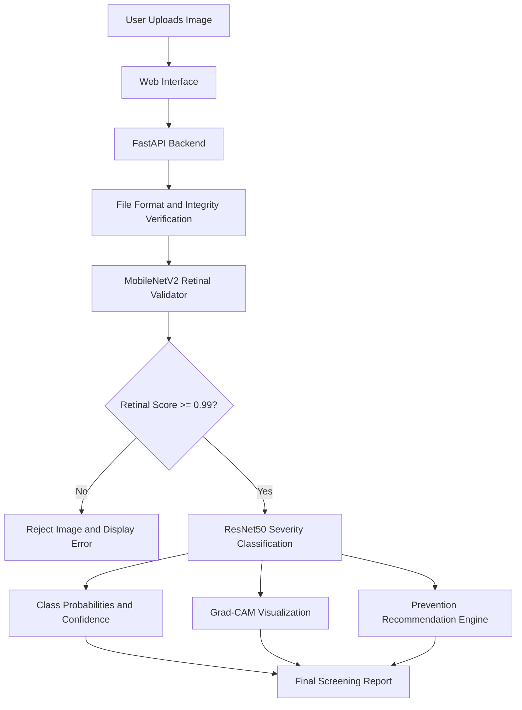
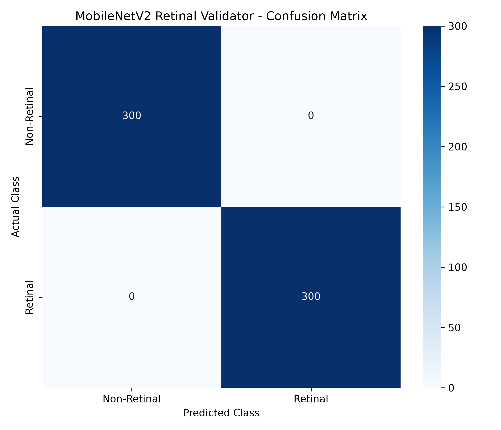
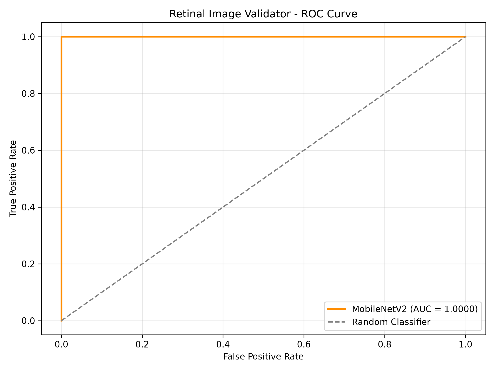
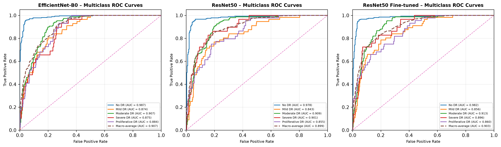

# RetinaAI — AI-Powered Diabetic Retinopathy Detection and Severity Assessment System


## Project Overview

RetinaAI is an AI-powered diabetic retinopathy screening and severity assessment system that uses deep learning to analyze retinal fundus photographs.

The system implements a two-stage deep learning architecture that validates uploaded retinal images before performing diabetic retinopathy severity classification. It integrates explainable artificial intelligence through Grad-CAM visualization and provides severity-based preventive recommendations.

The application combines machine learning, computer vision, explainable AI and full-stack web development into a unified screening platform.

**Project Status:** Local prototype implemented and tested. Cloud deployment is in progress.

## Key Features

- Retinal fundus image validation using MobileNetV2.
- Rejection of images that fail retinal validation.
- Five-class diabetic retinopathy severity classification using ResNet50.
- Prediction confidence and class-wise probability visualization.
- Grad-CAM-based explainable AI visualization.
- Severity-based prevention recommendation engine.
- Interactive web-based screening interface.
- Printable screening reports.
- Image format, file size and integrity verification.
- FastAPI-based REST API.
- Docker-based deployment configuration.

## System Architecture



## Diabetic Retinopathy Severity Classes

| Class ID | Severity Level |
|---|---|
| 0 | No DR |
| 1 | Mild DR |
| 2 | Moderate DR |
| 3 | Severe DR |
| 4 | Proliferative DR |

## Technology Stack

| Category | Technologies |
|---|---|
| Programming Language | Python |
| Deep Learning | TensorFlow, Keras |
| Model Architectures | ResNet50, EfficientNet-B0, MobileNetV2 |
| Transfer Learning | ImageNet Pretrained Models |
| Image Processing | OpenCV, Pillow |
| Data Processing | NumPy, Pandas |
| Model Evaluation | Scikit-learn |
| Data Visualization | Matplotlib |
| Explainable AI | Grad-CAM |
| Backend | FastAPI |
| Frontend | HTML5, CSS3, JavaScript |
| Application Server | Uvicorn |
| Development Environment | VS Code, Jupyter Notebook |
| Version Control | Git, GitHub |
| Containerization | Docker |
| Planned Model Hosting | Hugging Face Hub |
| Planned Application Hosting | Hugging Face Spaces |

## Dataset

### APTOS 2019 Blindness Detection

The diabetic retinopathy classification models were developed using the APTOS 2019 Blindness Detection dataset, containing 3,662 labeled retinal fundus photographs across five severity categories.

Dataset source: https://www.kaggle.com/competitions/aptos2019-blindness-detection

### Class Distribution

| Severity | Total | Training | Validation | Testing |
|---|---:|---:|---:|---:|
| No DR | 1,805 | 1,263 | 271 | 271 |
| Mild DR | 370 | 259 | 55 | 56 |
| Moderate DR | 999 | 699 | 150 | 150 |
| Severe DR | 193 | 135 | 29 | 29 |
| Proliferative DR | 295 | 207 | 44 | 44 |
| **Total** | **3,662** | **2,563** | **549** | **550** |

### Dataset Splitting

- Training: approximately 70%
- Validation: approximately 15%
- Testing: approximately 15%
- Stratified splitting to preserve class distribution.

### Retinal Image Validation Dataset

A separate binary classification dataset was constructed using retinal fundus photographs from APTOS 2019 and non-retinal images from CIFAR-10.

CIFAR-10 source: https://www.cs.toronto.edu/~kriz/cifar.html

| Dataset Split | Retinal | Non-Retinal | Total |
|---|---:|---:|---:|
| Training | 1,400 | 1,400 | 2,800 |
| Validation | 300 | 300 | 600 |
| Testing | 300 | 300 | 600 |
| **Total** | **2,000** | **2,000** | **4,000** |

The original datasets are not included in this repository.

## Image Preprocessing

The project implements image preprocessing and augmentation techniques to prepare images for deep learning models.

- RGB image conversion.
- Image resizing to 224 × 224 pixels.
- Conversion to floating-point tensors.
- Model-specific input preprocessing.
- Training-time image augmentation.
- Dataset batching and prefetching.
- Stratified dataset splitting.

## Deep Learning Models

### Model 1 — MobileNetV2 Retinal Image Validator

MobileNetV2 is used as a binary classification model to determine whether an uploaded image resembles a retinal fundus photograph.

Architecture:

```text
Input Image (224 × 224 × 3)
            |
    Data Augmentation
            |
     Input Rescaling
            |
 MobileNetV2 (ImageNet)
            |
 Global Average Pooling
            |
     Dense (128, ReLU)
            |
       Dropout (0.3)
            |
     Dense (1, Sigmoid)
            |
      Retinal Score
```

Configuration:

| Parameter | Value |
|---|---|
| Pretrained Weights | ImageNet |
| Input Shape | 224 × 224 × 3 |
| Optimizer | Adam |
| Learning Rate | 0.001 |
| Loss Function | Binary Cross-Entropy |
| Batch Size | 16 |
| Maximum Epochs | 10 |
| Total Parameters | 2,422,081 |
| Trainable Parameters | 164,097 |
| Acceptance Threshold | 0.99 |

### Model 2 — ResNet50 Severity Classification

ResNet50 is used as the final diabetic retinopathy severity classification model.

The architecture uses transfer learning to extract visual features from retinal fundus photographs and classify them into five severity categories.

```text
Input Image (224 × 224 × 3)
            |
    ResNet50 (ImageNet)
            |
 Global Average Pooling
            |
       Dropout
            |
    Dense (5, Softmax)
            |
   DR Severity Prediction
```

### Comparative Model Experiments

The project investigates multiple deep learning configurations, including:

- EfficientNet-B0 baseline.
- EfficientNet-B0 fine-tuning.
- ResNet50 baseline.
- ResNet50 with oversampling.
- ResNet50 fine-tuning.

The baseline ResNet50 model was selected for application integration.

## Model Performance

### Diabetic Retinopathy Classification

| Model | Test Accuracy | Macro F1-Score | Weighted F1-Score |
|---|---:|---:|---:|
| EfficientNet-B0 | 74.55% | 57.93% | 75.41% |
| EfficientNet-B0 Fine-tuned | 69.64% | 52.82% | 70.27% |
| ResNet50 Oversampled | 70.00% | 53.01% | 70.48% |
| **ResNet50 Baseline** | **75.64%** | **59.07%** | **75.86%** |
| ResNet50 Fine-tuned | 75.09% | 59.14% | 75.54% |

The final ResNet50 model achieved the highest test accuracy among the listed experiments. The fine-tuned ResNet50 achieved a marginally higher macro F1-score.

### Retinal Image Validator Performance

The MobileNetV2 validator was evaluated on a held-out dataset containing 600 images.

| Evaluation Metric | Result |
|---|---:|
| Test Accuracy | 100% |
| Precision | 100% |
| Recall | 100% |
| F1-Score | 100% |
| ROC-AUC | 1.00 |
| False Acceptance Rate | 0% |
| False Rejection Rate | 0% |
| True Positives | 300 |
| True Negatives | 300 |
| False Positives | 0 |
| False Negatives | 0 |

A supplementary service-level test involving 24 images also produced correct predictions for all supplied samples.

These results are specific to the evaluated APTOS and CIFAR-10 samples and do not establish performance on all real-world images. Independent external validation remains necessary.

### Validator Confusion Matrix



### Validator ROC Curve



### Model ROC Curve Comparison



## Explainable Artificial Intelligence

Gradient-weighted Class Activation Mapping (Grad-CAM) is integrated to visualize image regions that contribute to the ResNet50 model's predictions.

The generated heatmap is overlaid on the retinal fundus photograph to provide a visual explanation of the classification output.

Grad-CAM supports model interpretability but does not independently confirm the presence or location of clinically significant retinal lesions.

## Prevention Recommendation Engine

The application includes a rule-based recommendation engine that generates severity-specific preventive guidance.

Recommendations cover topics such as:

- Regular retinal screening.
- Blood glucose management.
- Blood pressure management.
- Healthy lifestyle practices.
- Consultation with qualified eye-care professionals.
- Appropriate follow-up and clinical evaluation.

The recommendation engine provides educational guidance and does not prescribe treatment.

## Application Workflow

1. The user uploads a retinal fundus photograph.
2. FastAPI verifies the uploaded file format, size and integrity.
3. MobileNetV2 evaluates the image against the retinal acceptance threshold.
4. Images that fail validation are rejected with an appropriate error message.
5. Accepted images are processed by the ResNet50 classification model.
6. The predicted severity and class probabilities are generated.
7. Grad-CAM produces an explanatory heatmap.
8. The recommendation engine generates severity-specific guidance.
9. The application displays a screening report that can be printed.

## Project Structure

```text
AI-Powered-Diabetic-Retinopathy-System/
|
|-- backend/
|   |-- app.py
|   |-- prediction.py
|   |-- services/
|       |-- __init__.py
|       |-- analysis_service.py
|       |-- gradcam.py
|       |-- recommendations.py
|       |-- retinal_validator.py
|
|-- frontend/
|   |-- index.html
|   |-- style.css
|   |-- script.js
|
|-- ml-model/
|   |-- config/
|   |-- preprocessing/
|   |-- models/
|   |-- notebooks/
|   |-- evaluation/
|   |-- gradcam_outputs/
|   |-- saved_models/
|
|-- .gitignore
|-- .dockerignore
|-- Dockerfile
|-- requirements.txt
|-- requirements-training.txt
|-- test_environment.py
|-- test_validator.py
|-- README.md
```

Dataset directories and trained model weights are maintained separately from the source repository.

## Installation and Local Setup

### Prerequisites

- Python 3.11
- Git
- pip
- Required trained model files

### Step 1 — Clone the Repository

Clone this repository using its GitHub clone URL and navigate into the project directory.

### Step 2 — Create a Virtual Environment

```bash
python -m venv .venv
```

Windows PowerShell:

```powershell
.\.venv\Scripts\Activate.ps1
```

Linux or macOS:

```bash
source .venv/bin/activate
```

### Step 3 — Install Dependencies

```bash
python -m pip install --upgrade pip
pip install -r requirements.txt
```

Verify dependency compatibility:

```bash
python -m pip check
```

### Step 4 — Configure Trained Models

The application requires the following trained model files:

```text
ml-model/saved_models/
|-- best_resnet50.keras
|-- retinal_validator.keras
```

The model files are not included in the Git repository. Public model hosting is planned, subject to applicable redistribution permissions.

The application supports the following environment variables:

| Variable | Purpose |
|---|---|
| MODEL_PATH | ResNet50 model location |
| VALIDATOR_MODEL_PATH | MobileNetV2 model location |
| VALIDATOR_THRESHOLD | Retinal acceptance threshold; default 0.99 |

### Step 5 — Run the Application

```bash
python -m uvicorn backend.app:app --host 127.0.0.1 --port 8000
```

Open the application in a browser:

```text
http://127.0.0.1:8000
```

Interactive API documentation:

```text
http://127.0.0.1:8000/docs
```

## API Documentation

| Method | Endpoint | Description |
|---|---|---|
| GET | / | Web application interface |
| GET | /health | Application health check |
| POST | /analyze | Retinal image validation and severity analysis |
| GET | /docs | Interactive API documentation |

### Image Analysis Endpoint

```text
POST /analyze
Content-Type: multipart/form-data
```

Request parameter:

| Parameter | Type | Description |
|---|---|---|
| file | Image file | JPG, JPEG or PNG image |

Successful responses include:

- Class ID.
- Predicted severity.
- Prediction confidence.
- Class-wise probabilities.
- Preventive recommendations.
- Medical disclaimer.
- Grad-CAM visualization.

### Error Handling

| HTTP Status | Description |
|---|---|
| 200 | Successful analysis |
| 400 | Invalid image format or contents |
| 413 | File exceeds the maximum permitted size |
| 422 | Image fails retinal fundus validation or request validation |
| 500 | Internal processing error |

The application enforces a maximum uploaded image size of 10 MB and a maximum image resolution of 25 million pixels.

## Deployment

The planned deployment architecture separates source code, trained model storage and application hosting.

```text
GitHub
   |
   |-- Source Code and Documentation
   |
Hugging Face Hub
   |
   |-- Trained Model Files
   |
Hugging Face Spaces
   |
   |-- Docker Container
   |-- FastAPI Backend
   |-- Web Frontend
   |-- Deep Learning Inference
```

The Docker-based deployment configuration is currently being finalized.

## Research Contributions

- Comparative evaluation of multiple transfer learning architectures.
- Two-stage retinal validation and disease severity classification.
- Investigation of class imbalance through oversampling.
- Integration of Grad-CAM-based model explainability.
- Severity-specific preventive recommendation generation.
- Development of an end-to-end web-based screening prototype.

## Limitations

- The disease classification model was evaluated primarily using the APTOS 2019 dataset.
- Class imbalance affects classification performance, particularly for minority severity categories.
- The retinal validator's reported performance is limited to the evaluated dataset sources.
- External retinal images, different imaging devices and unfamiliar non-retinal images require further evaluation.
- Retinal validation does not guarantee sufficient image quality for clinical assessment.
- Model confidence scores should not be interpreted as calibrated clinical probabilities.
- The system has not undergone prospective clinical validation.

## Future Enhancements

- Independent external dataset validation.
- Hard-negative training for improved retinal image validation.
- Retinal image quality assessment.
- Improved minority-class classification.
- Model calibration and uncertainty estimation.
- Model optimization for faster inference.
- Multi-dataset training and evaluation.
- Cloud deployment and performance monitoring.

## Acknowledgements

- APTOS 2019 Blindness Detection dataset.
- CIFAR-10 dataset.
- TensorFlow and Keras open-source communities.
- ResNet, EfficientNet and MobileNet research communities.
- Grad-CAM research and explainable AI methodologies.

## Medical Disclaimer

RetinaAI is an academic research and educational prototype. It is not a clinically validated medical device and must not be used as a substitute for professional medical diagnosis, treatment or clinical decision-making.

Only authorized, appropriately de-identified images should be used with the application. Users should consult qualified eye-care professionals for clinical evaluation and treatment decisions.